
<a href="https://www.theao.in"></a> <a href="https://ephah.cloud"></a><a href="https://www.theao.in"></a><a href="https://github.com/ramlimicheal/APEX-V6-KERNEL"></a> <a href="https://www.theao.in"></a><a href="https://preachr.church"></a><a href="https://www.theao.in"></a> <a href="https://www.theao.in"></a><a href="https://github.com/ramlimicheal/STS-The-Semantic-Token-Standard-for-AI-Trust"></a><a href="https://github.com/ramlimicheal/madmikebeatsfinal"></a> <a href="https://www.theao.in"></a>

